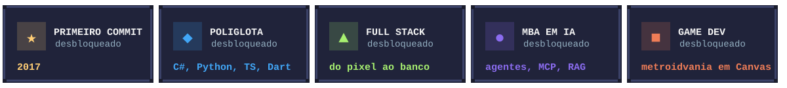
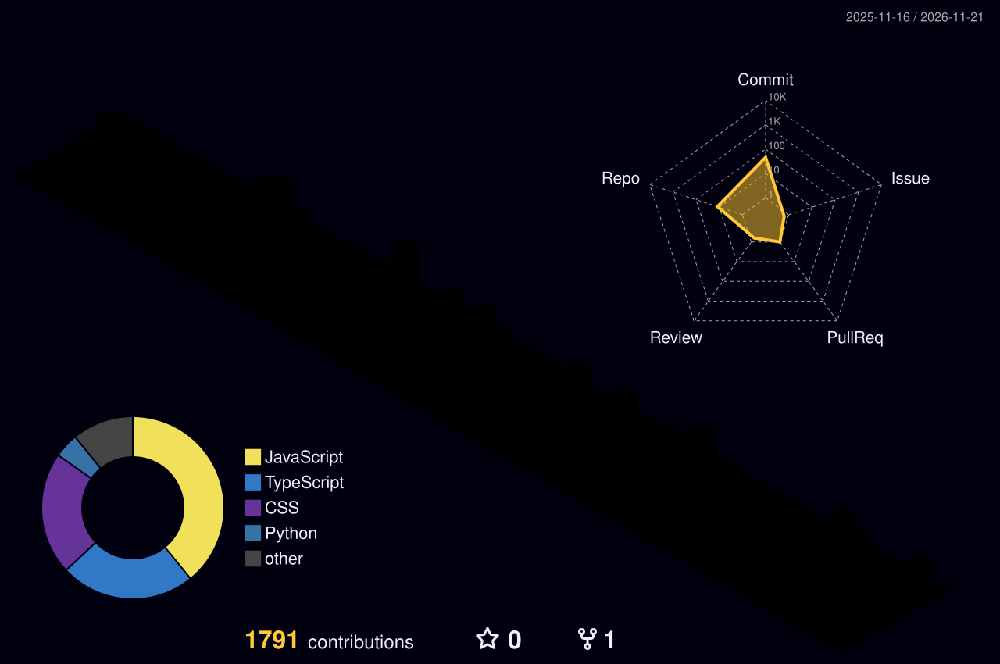

> **Lore.** Comecei pelo front-end, atravessando o reino dos frameworks (Angular, React, Vue, Ionic, Flutter). Desci a pilha até APIs, bancos e nuvem. Hoje trabalho no PicPay e, nas horas vagas, treino as artes da IA: agentes, MCP, RAG e avaliação de prompts. Também construo jogos e vídeos animados em código, porque é jogando que se aprende.

## 🎒 Inventário

| Slot | Itens equipados |
|:--|:--|
| **Arma principal** |  |
| **Arma secundária** |  |
| **Armadura** |  |
| **Montaria** |  &nbsp;+ Ionic e Expo |
| **Acessórios** |  |
| **Grimório** | Agentes de IA · MCP · RAG · avaliação de prompts · Gemini · OpenAI |

## 📜 Diário de missões

| Status | Missão | Recompensa |
|:--:|:--|:--|
| ✅ | [**codecampus**](https://github.com/thiago-alcaras/codecampus) | Plataforma educacional full stack com FastAPI, PostgreSQL, design system próprio e arquivos privados no S3. |
| ✅ | [**lead-local**](https://github.com/thiago-alcaras/lead-local) | Prospecção de negócios locais com Gemini: pesquisa com fontes, abordagem comercial e prompt para landing page. |
| ✅ | [**promptlab**](https://promptlab-bice.vercel.app) | Laboratório para testar e comparar prompts, no ar na Vercel. |
| ⚔️ | **Vizin** 🔒 privada | Rede social de bairro: feed, mapa, avisos, eventos e moderação. Web (PWA) e app Android/iOS com React, Node, Supabase e Expo. |
| ⚔️ | **Diviners** 🔒 privada | Metroidvania de plataforma em HTML5 Canvas, sem nenhuma dependência. |
| ⚔️ | **Rota Incerta** 🔒 privada | Minisséries de mistério em vídeo vertical, animadas em código. O público vota e decide o próximo episódio. |

## 🏆 Conquistas

<picture>
  <source media="(prefers-color-scheme: dark)" srcset="https://raw.githubusercontent.com/thiago-alcaras/thiago-alcaras/output/profile-3d-contrib/profile-night-rainbow.svg"/>
  <source media="(prefers-color-scheme: light)" srcset="https://raw.githubusercontent.com/thiago-alcaras/thiago-alcaras/output/profile-3d-contrib/profile-gitblue.svg"/>
  
</picture>

## 👾 Fase bônus

<picture>
  <source media="(prefers-color-scheme: dark)" srcset="https://raw.githubusercontent.com/thiago-alcaras/thiago-alcaras/output/pacman-contribution-graph-dark.svg"/>
  <source media="(prefers-color-scheme: light)" srcset="https://raw.githubusercontent.com/thiago-alcaras/thiago-alcaras/output/pacman-contribution-graph.svg"/>
  
</picture>

  🤝 <a href="https://www.linkedin.com/in/thiago-alcaras/"><b>Convidar para a party (LinkedIn)</b></a> &nbsp;·&nbsp;
  🗺️ <a href="https://thiago-alcaras.github.io"><b>Mapa do mundo (portfólio)</b></a> &nbsp;·&nbsp;
  

